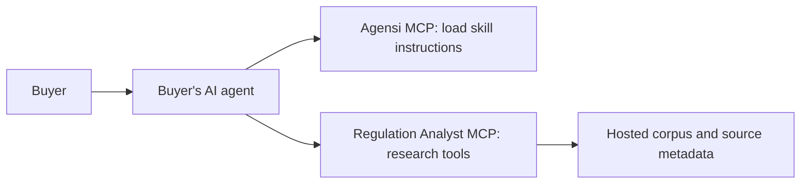

# Agensi publishing plan

Prepared 8 November 2026 from Agensi's public documentation and this repository. This is a plan; no service was deployed or listing submitted.

**Recommendation:** publish a single Regulation Analyst skill that uses an independently available research service. Agensi distributes skill instructions through MCP; it does not run our application or host our MCP server. Its documentation explicitly supports skills that use an external MCP server, declared under “Needs access to.” Installed plugins and server configurations are not marketplace products. [Supported products](https://www.agensi.io/docs/what-you-can-sell)

The intended experience is:



These are two separate connections. Loading the Agensi skill does not automatically install, connect, or authorize our service.

1. **Define the first release and access model.**

   Start with source-backed Indian company financial research and explicitly dated regulatory queries. Keep buyer access read-only initially; ingestion remains an operator workflow. This reduces operating cost and avoids exposing shared data mutation to marketplace buyers.

   Two launch paths are possible:

   | Path | Work required | Suitable audience |
   | --- | --- | --- |
   | Skill using an already configured local server | Package instructions and document the separately installed service | Existing users and a technical pilot; confirm acceptability if local installation is central to the listing |
   | Skill using a hosted remote MCP service | Add remote transport, authentication, hosting and access provisioning | Recommended public marketplace experience |

   A text-only methodology skill is another product, but would not preserve this application's verified calculations and corpus access.

2. **Reconcile the current project with launch claims.**

   | Repository evidence | Implication |
   | --- | --- |
   | `src/regulation_analyst/mcp_server.py` exposes ten default tools, including coverage checks, calculations, sources and dated regulations | Reuse these capabilities; optional ingestion is an additional tool |
   | `src/regulation_analyst/cli.py` starts MCP with `transport="stdio"` | Remote MCP access needs implementation and client testing |
   | `src/regulation_analyst/api.py` uses one bearer token and shared jobs/storage | Existing HTTP API is not a buyer account or tenant system; do not distribute its administrative token |
   | `Dockerfile` starts the REST API | Container deployment does not currently expose MCP |
   | `render.yaml` selects a free instance without a disk | Newly ingested data will not persist across restarts; README deployment guidance differs |
   | Read-only inspection found 271 facts and six company records in both `deploy/seed.sqlite3` and `data/research.sqlite3` | README's 33-fact description is stale; record presence does not establish complete coverage |
   | Seed export omits archived PDFs | Hosted page images require separately available archives; citation metadata alone is insufficient |
   | No marketplace `SKILL.md` or project license file was found | Prepare the skill and decide distribution terms before release |

   Company IDs observed: hcltech, indigo, infosys, tatamotors, tcs, wipro. Produce a fresh coverage report by year, metric, accounting basis and trust level. Independently inspect representative source cells. Existing documentation describes narrow historical regulation coverage and incomplete live-model validation; do not advertise current-law completeness or audited accuracy without new evidence.

3. **Make the research service accessible.**

   For the hosted route, expose the existing tool service over authenticated HTTPS MCP, using a transport supported by the target clients. Keep stdio for local use. Test authentication and connection flows in each client advertised as compatible.

   Provide buyer-specific, revocable access using the authentication mechanism those clients support. Add request limits, timeouts, usage monitoring and separate administrative credentials. A shared public research corpus can remain shared; private uploads, queries and job histories need user isolation if offered later.

   Configure persistent storage for SQLite and archives, backups, a health endpoint and restart verification. SQLite can support an initial modest deployment; scaling and concurrent writes need assessment before expansion. The React frontend is optional for this integration.

   Deterministic tools can operate without a backend model key; the buyer's AI client supplies its own model. Server-side agent runs, model-assisted ingestion or hosted embeddings introduce provider credentials and charges. Keep those credentials on the server and disclose any buyer prerequisites.

   **Unresolved integration:** the reviewed documentation does not establish a purchase webhook or entitlement API for automatically granting access to our backend. Before promising paid service access, verify provisioning and revocation with Agensi, including refunds and subscription expiry. Do not treat a purchase ID appearing in skill text as an authenticated backend credential. Agensi also prohibits external checkout and upsell links in listings. [Submission rules](https://www.agensi.io/docs/submit-on-the-website)

4. **Create a small marketplace package.**

   Proposed contents:

   ```text
   regulation-analyst-skill/
     SKILL.md
     references/tool-guide.md
     references/coverage-and-limitations.md
     references/connection-guide.md
     templates/research-report.md
   ```

   `SKILL.md` should include name/description frontmatter, trigger conditions, prerequisites and workflow: inspect coverage, select company/year/scope/basis/trust, fetch facts, calculate using tools, resolve sources, and report unsupported requests. Require an explicit as-of date for regulations. Preserve citations and disclose automated extraction. Document that client-generated prose is outside the backend renderer's validation guarantee.

   Upload a dedicated ZIP rather than this repository. Website limits are 50 MB and 1,000 files; bundled environments/dependencies are prohibited. Binary assets are not delivered to the buyer's agent. Scripts run individually from temporary files and cannot rely on sibling package files, so shipping the Python application as skill scripts will not preserve its normal imports and database access. [Packaging](https://www.agensi.io/docs/packaging)

5. **Validate the complete buyer workflow.**

   Test locally before submission: Agensi serves skills only once live. After approval, test the actual Agensi loading flow. [Creator FAQ](https://www.agensi.io/docs/creator-faq)

   Acceptance cases: successful financial comparison with reproducible calculations and page citations; missing company/year; incompatible accounting bases; automated versus reviewed facts; unsupported regulation dates; missing connection; rejected credentials; service timeout. For hosted access, also verify quotas, user isolation where applicable, restart persistence and archive availability. Run existing relevant tests plus tests for transport/auth changes; historical pass counts are not fresh validation.

6. **Prepare the account and listing.**

   Enable Creator Mode and complete the creator profile. Paid listings require payout setup; free listings do not. [Creator quickstart](https://www.agensi.io/docs/creator-quickstart)

   Prepare a unique name, summary, Markdown description, compatibility requirements, limitations, real request/result demonstration and support/docs link. A square 512 × 512 logo is recommended. Suggested categories: Research & Analysis, Finance & Accounting, and Legal & Compliance, subject to the final scope. Explicitly declare access to the Regulation Analyst server. [Listing fields](https://www.agensi.io/docs/submit-on-the-website)

   Pricing options include free, one-time from $1, or subscription from $5/month. Select pricing only after deciding who funds hosting and model usage. [Pricing](https://www.agensi.io/docs/pricing-your-skill)

   Agensi states a 70% creator share of net sale price excluding VAT. If registering from India, its published geographic rules point to Zoneless payouts in USDC on Solana; verify account eligibility during onboarding. [Payouts](https://www.agensi.io/docs/earnings-and-payouts)

7. **Submit and operate.**

   Upload at https://www.agensi.io/dashboard/submit, review detected permissions and the preview, then submit. Expect security scanning, AI review and human approval; published guidance allows up to 48 hours. Remove secrets and unnecessary files and resolve findings without hiding required network behavior. [Review process](https://www.agensi.io/docs/review-and-approval)

   Maintain versioned skill instructions, service compatibility, coverage dates and a changelog. Agensi loads the newest live skill; keep backend tools compatible with published instructions. [Skill delivery](https://www.agensi.io/docs/how-agents-load-skills)

**Inputs needed before implementation:** preferred pilot versus hosted launch; free versus paid; target AI clients; hosting account/budget and HTTPS endpoint; buyer provisioning decision; creator account/profile and payout setup if paid; approved corpus and distribution rights; branding and support contact. Model credentials are conditional on enabled server-side features.

**Ready-to-submit gate:** usable service access, validated coverage claims, tested skill ZIP, complete listing, and working payouts if paid. Packaging alone is insufficient for an agent that depends on this backend.
