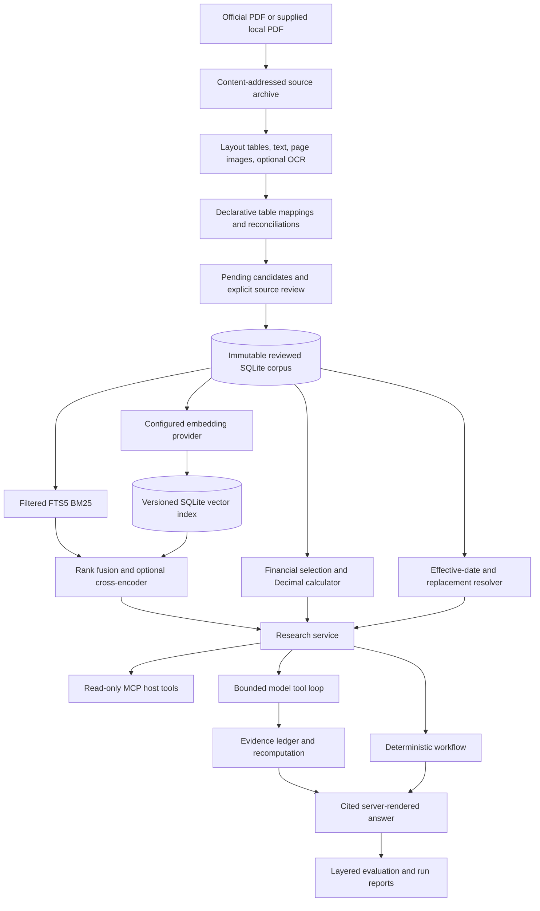

# Architecture

## Data design

Companies define fiscal calendars and aliases. Documents preserve official URLs, document kind,
publication/capture dates, and optional snapshot hashes. Evidence records carry PDF/printed pages,
sections, table/row/column locators, boxes, and review identity/method/date.

Financial facts preserve raw strings and units, explicit periods, scope, accounting basis,
versioned definitions, and revision relationships. Normalized crore values are derived when
queried. Passage records distinguish excerpts from reviewed summaries and management from other
speakers. Provisions carry effective/verified intervals, entity applicability, and explicit
replacement IDs. Provenance belongs to each record rather than an answer-wide decorative citation.

Typed imports validate the merged reference graph and commit atomically. Identical imports are
idempotent; changed values require new IDs. SQLite research connections are opened read-only.
The corpus version hashes stored canonical payloads. Vector manifests and run reports pin that
version; source snapshots and review candidates use SHA-256 integrity checks.

## Module map

| Module | Responsibility |
|---|---|
| `models.py`, `store.py` | Strict records, graph validation, immutable persistence, selection, temporal resolution |
| `numbers.py`, `metrics.py` | Number parsing, unit conversion, definition-bound Decimal formulas |
| `acquisition.py`, `ingestion.py` | Bounded official source archives and layout/OCR extraction artifacts |
| `review.py` | Declarative cell mapping, diagnostics, explicit review promotion |
| `providers.py`, `retrieval.py` | Real model adapters, local model fingerprints, dense indexing, fusion, reranking |
| `service.py` | Shared research operations and structured result envelopes |
| `answering.py` | Deterministic question routing, calculation verification, citations and gaps |
| `agent.py` | Strict tool schemas, bounded orchestration, evidence ledger, canonical rendering and run logs |
| `evaluation.py`, `experiments.py` | Smoke regression and provenance-rich comparative experiments |
| `cli.py`, `mcp_server.py` | Administration/research commands and read-only MCP integration |

## Financial invariants

- No floating-point money and no arbitrary expression evaluation.
- Explicit company, scope, basis, fiscal periods, and comparable metric definitions.
- No annualization of quarter/TTM data or silent substitution of unsupported accounting standards.
- Net margin uses owners' profit. Operating margin requires the approved operating-profit definition.
- ROE uses opening/closing owners' equity. CAGR uses actual elapsed fiscal-year intervals.
- Reported and adjusted numbers are distinct; no inferred revision winner for conflicting values.
- Unknown publication dates are excluded when a knowledge cutoff is requested.
- Rounding occurs for display; full Decimal results and formula/input lineage remain available.

## Boundaries

Review assertions and official-source accuracy require real verification outside type checks.
A hash proves byte identity, not truth. The deterministic and agent renderers constrain numerical
claims; external MCP-client prose is outside that guarantee. Reviewed narrative selection is
traceable, but completeness and causal entailment still need evaluation. Legal versioning only
resolves imported histories. The current small corpus does not establish present-day regulation.

The local exact-cosine index is appropriate for this corpus and avoids a second service. A larger
corpus can replace the index behind the retrieval interface. PyMuPDF is the selected parser;
additional parsers are a measured future decision, not an untested fallback.
