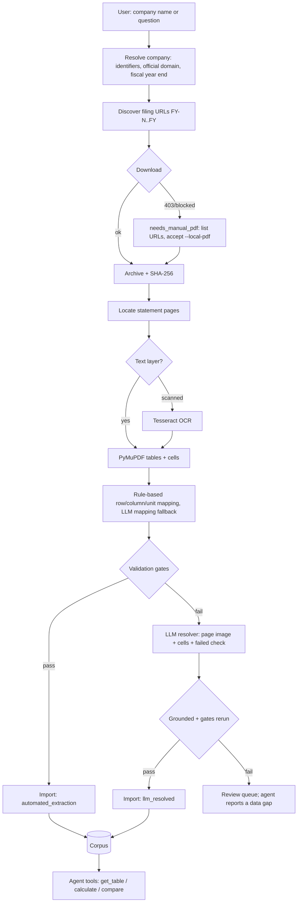

# Automatic company ingestion plan

Goal: a user types any BSE/NSE-listed company name. The system finds that company's official
filings, downloads them, extracts an expanded set of financial facts with parsing, OCR, and an
LLM fallback, imports the values that pass validation, and the agent answers questions by
calling calculation tools over those facts.

Decisions (30 Oct 2026):

| Topic | Decision |
|---|---|
| Company scope | Indian listed companies (BSE/NSE), consolidated and standalone Ind AS, INR |
| Trust model | Automatic import only when validation checks pass. When checks fail, the LLM chooses a value that is grounded in the page; the checks then rerun. Values that still fail go to a review queue. Every value keeps a trust label. |
| LLM | OpenAI (extend the existing `OpenAIProvider`) |
| Metrics | Expanded set (see §4) |

## 1. End-to-end flow

### Core rule

The LLM never types a number into the corpus. It **selects a location**: a table, row, and
column, or a text span on a page. The system then reads the value from the parser or OCR text
at that location, checks that the value string actually occurs there, and reruns every gate.
This preserves the existing guarantee that every number traces to a source location.

## 2. Phase 1: Foundations (≈3 days) — done

Implemented: trust labels and validation on `Evidence`; reviewed facts outrank automated ones in
`select_fact`; `--trust reviewed_only`; citations marked "(unreviewed: …)"; the
`ingestion_jobs` table (schema v2; v1 databases still read and migrate on the next write);
`OpenAIProvider.structured()`, `image_input()`, and `UsageBudget`. Tests:
`tests/test_trust_and_jobs.py`.

1. **Git init and CI.** Commit the current state before the trust model changes.
2. **Trust labels in the data model** (`models.py`, `store.py`):
   - Extend `Evidence.review_method` with `automated_extraction` and `llm_resolved`.
   - Add `Evidence.checks` (passed and failed gate names) and `Evidence.resolution_note`
     (the LLM's stated reasoning, when used).
   - Add an `ingestion_jobs` table (company, document, stage, status, error) so runs can
     resume and repeated runs are idempotent.
   - Add a selection policy `trust: reviewed_only | allow_automated` (default
     `allow_automated`). Every answer and table row renders its trust label.
3. **Writable ingestion store.** Research connections stay `mode=ro`. Ingestion uses a separate
   writer connection and the existing atomic `import_bundle` path.
4. **OpenAI provider additions** (`providers.py`): a `structured()` call using a JSON schema
   response format, image/PDF-page inputs for the resolver, and the `web_search` tool for
   discovery. Keep the existing redaction and no-retry behavior; add a per-ingestion token budget.

## 3. Phase 2: Discovery and acquisition (≈4 days), new module `discovery.py`

1. **Resolve the company.** The LLM, using `web_search`, returns a strict schema: legal name,
   aliases, NSE symbol, BSE code, ISIN, official website domain, and fiscal year end. The user
   confirms an ambiguous match (for example, "Tata" maps to many companies).
2. **Find documents.** For each requested year, look for annual-report and audited-results PDF
   URLs. Rank candidates by domain, title, and year.
3. **Per-company domain allowlist.** Replace the fixed `OFFICIAL_DOMAINS` check with:
   static exchange and regulator domains, plus the domain confirmed in step 1, stored on the
   `Company` record. Arbitrary hosts are not accepted.
4. **Blocked downloads.** BSE, NSE, Infosys, and TCS returned 403 to scripted requests from
   this machine. On 403 or a timeout, mark the job `needs_manual_pdf`, print the URLs, and
   accept `ingest <company> --local-pdf FY25=/path.pdf`. Do not add bot-detection evasion.
5. **CLI:** `regulation-analyst ingest "Wipro" --years FY23 FY25 [--local-pdf ...] [--dry-run]`.

## 4. Phase 3: Expanded metrics and formulas (≈3 days)

**Extracted (reported) metrics**, each with a versioned definition in `metrics.DEFINITIONS`:

| Statement | Metrics |
|---|---|
| P&L (annual) | revenue, other_income, total_income, finance_costs, depreciation_amortisation, profit_before_tax, tax_expense, profit_total, profit_owners, eps_basic, eps_diluted |
| Balance sheet (instant) | equity_owners, non_controlling_interest, total_assets, current_assets, current_liabilities, borrowings_current, borrowings_noncurrent, cash_and_equivalents |
| Cash flow (annual) | operating_cash_flow, capex (purchase of PPE and intangibles) |

**Derived, never extracted.** This also resolves the TCS/Infosys operating-profit mismatch:
- `operating_profit.derived.v2` = profit_before_tax + finance_costs − other_income
- `ebitda.derived.v1` = operating_profit + depreciation_amortisation

**New formulas:** ebitda_margin, debt_to_equity, roce (EBIT ÷ (total_assets − current_liabilities)),
interest_coverage, free_cash_flow (OCF − capex), current_ratio, roe_change_pp, and EPS growth.

**Unit model:** add `INR_per_share` for EPS. EPS is not normalized to crore, and formulas reject
mixing per-share values with monetary values.

## 5. Phase 4: Automatic extraction (≈5 days), new module `autoextract.py`

1. **Locate statement pages.** Score each page's text for headings such as "Consolidated
   Statement of Profit and Loss", "Balance Sheet", and "Statement of Cash Flows". If scores are
   ambiguous, the LLM classifies only the shortlisted pages. Prefer consolidated statements; fall
   back to standalone only for companies without subsidiaries, and label the scope.
2. **Scanned pages.** If a page has no text layer, run Tesseract OCR (already supported). If
   Tesseract is missing, send the page to the review queue rather than reading numbers from an
   image with the LLM.
3. **Automatic mapping** that generates the existing `MappingPlan` instead of a hand-written
   JSON file:
   - Row-label synonym table per metric (for example, "Profit attributable to owners of the
     Company", "Owners of the parent", "Equity holders of the Company").
   - Column-year detection ("Year ended March 31, 2025", "FY 2024-25", "31.03.2025").
   - Unit detection from headers ("₹ in crore", "in lakhs", "₹ million").
   - **LLM mapping fallback:** when no rule matches, the LLM returns
     `{table, row, column, metric}`, never a value.
4. Reuse `review.build_candidates`, then send candidates to the gates instead of a human.

## 6. Phase 5: Validation gates and LLM resolver (≈5 days), new module `validation.py`

| Gate | Check | On failure |
|---|---|---|
| G1 Grounding | The value string occurs in the cell or OCR text at its location | Resolver |
| G2 Period and unit | Column year matches the fact; one unit per table; instant vs. annual | Resolver |
| G3 Accounting identities | PBT − tax = profit_total; owners + NCI = profit_total; total assets = equity + liabilities; cash-flow roll-forward; revenue + other income = total income | Resolver |
| G4 Cross-document | Comparative columns in the FY(N+1) report match the FY(N) report; a mismatch must be an explicit restatement | Resolver, or store both with `revision: restated` |
| G5 Plausibility | Sign checks, margin within −100%…100%, unit-scale outliers (10×, 100×, 1000× year-on-year jumps) | Warning; blocks only scale outliers |

Tolerances are in crore and configurable, because statements round.

**LLM resolver.** It receives the page render (PNG), the extracted cell grid, the candidate
value, and the failed gate with numbers. It returns
`{choice: cell_ref | "cannot_determine", reason}` using a strict schema. The system then checks
G1 grounding at the chosen location and reruns all gates. If they pass, the value is imported as
`llm_resolved` with its reason stored. Otherwise it goes to the review queue, which is visible
in a `review-queue` command and as gaps in answers. The resolver gets at most 2 attempts per value.

## 7. Phase 6: Agent integration (≈3 days)

1. New agent tools in `agent.py`:
   - `ensure_company_data(company, years)` returns coverage, trust labels, and missing metrics.
   - `ingest_company(company, years)` runs the pipeline or resumes a job. It is enabled only in
     the CLI agent with `--allow-ingest`. MCP stays read-only unless `serve --allow-ingest` is set.
2. Flow: the question names an unknown company → the agent calls `ensure_company_data` →
   `ingest_company` → `get_table` / `calculate` / `compare_companies`. Existing ledger rules still
   apply: calculations are recomputed and numbers are rendered by the server.
3. Ingestion runs outside the agent's 180 s budget, with its own time and token budget and
   progress output. If it is blocked (`needs_manual_pdf`), the agent tells the user which PDFs
   to supply.
4. The deterministic `ask` command uses the same coverage check and suggests `ingest` when data
   is missing.

## 8. Phase 7: Measure accuracy (≈3 days)

- **Gold set:** the 33 existing source-crosschecked Infosys and TCS facts. Run automatic
  ingestion on the same PDFs, supplied locally, and score exact matches per metric, per gate, and
  per trust label (`automated_extraction` vs `llm_resolved`).
- Add 3–5 new companies with one hand-checked year each (including one scanned report and one
  report in lakhs) to measure how well the pipeline generalizes.
- Report: accuracy and coverage per metric, the share resolved by the LLM and the resolver's
  accuracy, the review-queue rate, cost and time per company.
- Unit tests: generated PDFs (existing pattern in `tests/test_pdf_and_mcp.py`), controlled
  OpenAI responses for discovery, mapping, and the resolver, each gate's pass and fail cases, and
  the resolver's invented-value rejection.

## 9. Order and estimate

| # | Phase | Est. | Needs from you |
|---|---|---|---|
| 1 | Foundations: trust labels, jobs, provider | 3 d | — |
| 2 | Expanded metrics and formulas | 3 d | — |
| 3 | Automatic extraction and mapping | 5 d | Local PDFs for Infosys/TCS (browser download) |
| 4 | Validation gates and LLM resolver | 5 d | `OPENAI_API_KEY`, `REGULATION_AGENT_MODEL` |
| 5 | Discovery and acquisition | 4 d | Same key; `brew install tesseract` |
| 6 | Agent integration | 3 d | — |
| 7 | Accuracy measurement | 3 d | Hand-check a few values for new companies |

Total: about 4–5 weeks. Phases 1–3 can be built and tested offline with controlled model
responses. The LLM-dependent phases need an API key to validate.

## 10. Risks

- **Download blocking.** Exchanges and company sites often block scripted downloads. The manual
  `--local-pdf` route is a required part of the design, not an edge case.
- **Layout variety.** Annual reports differ widely. The synonym table and gates will need tuning
  per failure; Phase 7 measures this.
- **LLM-resolved values** are grounded, but the LLM may choose the wrong grounded cell, for
  example a standalone figure instead of the consolidated one. That is why gates rerun after
  resolution and why the label is visible in every answer.
- **Docs to update afterwards:** README, ARCHITECTURE (the "extraction never silently promotes"
  rule becomes "promotes only through gates, labeled by trust"), and PROJECT_STATUS.
